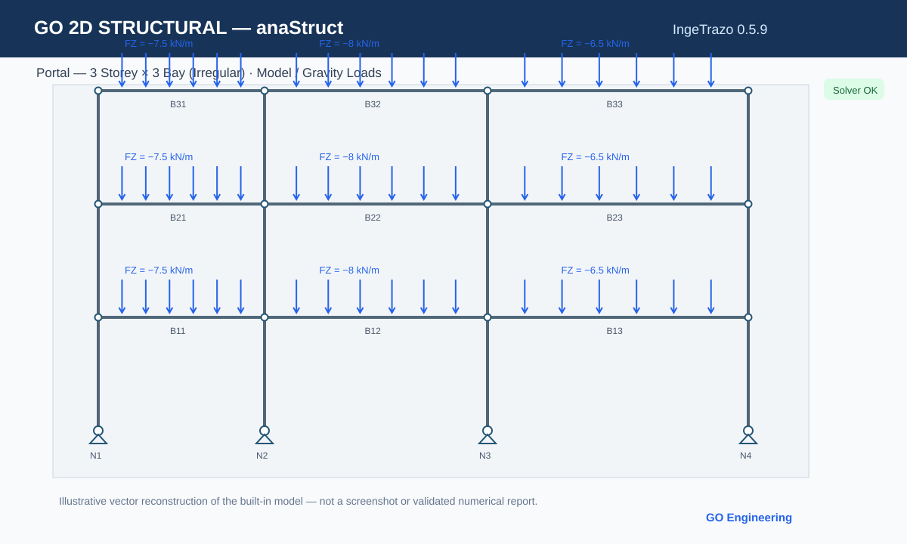
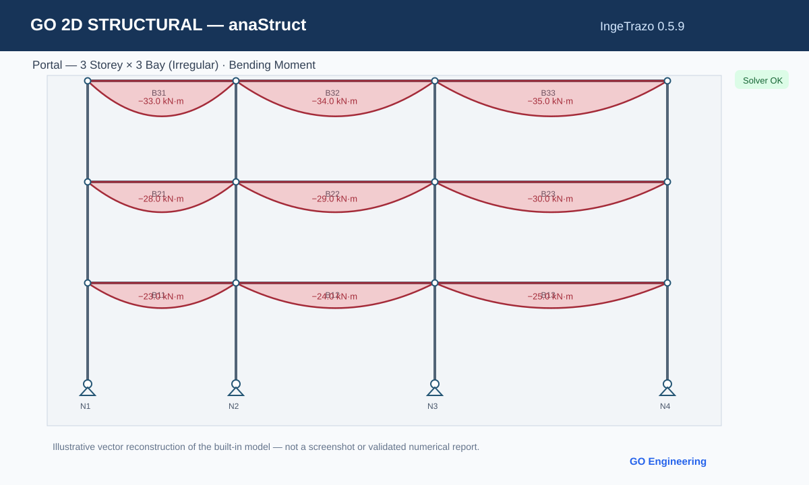

# GO 2D Structural — anaStruct

**v0.5.5 Community Preview candidate** for **IngeTrazo 0.5.9 / Windows 10–11 x64**, powered by **anaStruct 1.7.0**.

> **Pre-release candidate:** The v0.5.5 installer/renderer/toolbar and standalone-runtime integration have not yet passed a full clean-machine Windows acceptance test. The existing v0.5.4 installation has been manually tested by the author.

## Examples

Built-in model: **Portal — 3 Storey × 3 Bay (Irregular)**. The vector illustrations below show the intended structure/diagrams; they are **not screenshots** or an engineering-results certificate.

## Features

- 2D beams / frames / trusses, fixed/pin/roller/spring supports
- Point forces and moments, constant/variable distributed loads, self-weight
- Load Cases and combinations (DL, LL, WL, SLS, ULS)
- N / V / M / Deflection / Deformed / Reactions with signed colors
- v0.5.5: collision-aware viewport labels with **Auto layout**, fewer labels at crowded zoom, full hover values preserved
- v0.5.5: stable GO 2D toolbar icon, **Open Panel** and **Analyze** actions
- v0.5.5: separate **anaStruct: Analyzed / Stale / Running** status, independent of any GO Structural Workspace analysis badge
- CSV, PDF selected-case, and full multi-case PDF report exports
- Optional self-contained Windows solver EXE support; separate portable runtime still **awaiting Windows CI build/verification**, Python-venv fallback available

## Download (candidate)

- [v0.5.5 plugin ZIP](dist/go_anastruct_2d-v0.5.5-plugin.zip) — exactly one `go_anastruct_2d/` package folder
- [SHA-256 checksum](dist/go_anastruct_2d-v0.5.5-plugin.zip.sha256)
- [Windows setup script](setup_windows.cmd) (requires full repository checkout/archive with `dist/`)
- [Windows portable-worker build and installation notes](docs/PORTABLE_RUNTIME.md)
- [v0.5.5 Windows test checklist](docs/V055_WINDOWS_QA.md)

### Install on IngeTrazo 0.5.9 for Windows

1. Download the **complete repository ZIP** for this branch and extract it.
2. Close IngeTrazo.
3. Double-click `setup_windows.cmd` (which invokes `install_windows.cmd`).
4. The installer verifies the v0.5.5 plugin ZIP checksum, backs up the previous copy and installs to `%APPDATA%\ingetrazo\plugins\go_anastruct_2d`.
5. Restart IngeTrazo. Open GO 2D anaStruct using its toolbar icon or Extensions menu.
6. Click **Check Solver**. If the solver is not ready, use **Install / Repair Solver**.
7. Run the included beam and 3-storey portal examples; check N/V/M/deflection and reactions.

If no verified prebuilt Windows worker is installed, the fallback may require Python 3.10–3.13 and Internet access for dependencies. The standard Community plugin ZIP does **not** contain a self-contained Python executable.

## Repository layout

- `go_anastruct_2d/` — editable v0.5.5 plugin source
- `scripts/package_plugin.py` — package builder
- `tools/worker_entry.py` and `scripts/build_windows_portable.ps1` — optional portable Windows worker build
- `dist/` — catalog candidate ZIP and SHA-256 file
- `docs/` — installation, guides, QA, and licensing notes
- `screenshots/` — vector illustrations; original Windows screenshots need a separate gallery upload

## Engineering and security

This is **experimental/pre-release** structural engineering software. Cross-check load combinations, equilibrium and critical results independently before professional use. Screen-space label layout never modifies numerical results. Solver execution is in a separate process; the GUI does not import anaStruct directly.

**License:** GPL-3.0-or-later for this preview repo. anaStruct 1.7.0 licensing metadata and its repository LICENSE text need reconciliation for binary redistribution — see [Third-party notices](THIRD_PARTY_NOTICES.md). The portable worker bundle is **not** declared released or approved until acceptance and license checks are complete.

[Source repository](https://github.com/buildsmart888/go-anastruct-2d) · GO Engineering / buildsmart888
