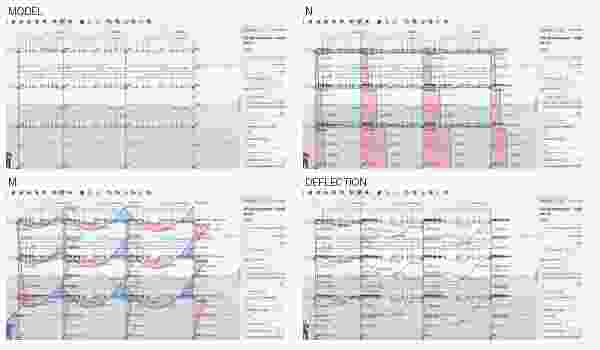

# GO 2D Structural — anaStruct

## 🚧 v0.5.7-preview — GO Engineering Core v0.1

This **draft feature branch** integrates a shared, unverified steel catalog
with the existing GO Factory Gable overlay. It removes accidental RC section
substitution for steel H/WF, requires explicit strong/weak bending-axis choice,
provides direct Loads / Combinations / Releases / Sections editing controls,
and preserves analytical changes on equivalent Factory re-imports.

- [v0.5.7-preview plugin ZIP](dist/go_anastruct_2d-v0.5.7-preview-plugin.zip) + [SHA-256](dist/go_anastruct_2d-v0.5.7-preview-plugin.zip.sha256)
- [Preview Windows installer](install_preview_057_windows.cmd)
- [Windows QA runner](RUN_GO_CORE_057_TESTS_WINDOWS.cmd)
- [Read installation + acceptance criteria](docs/V057_STEEL_CORE_PREVIEW.md)
- [GO Factory companion v0.3.2-preview](https://github.com/buildsmart888/go-factory-generator/tree/feat/go-core-v01-steel-catalog)

The separately built anaStruct 1.7.0 worker is unchanged. **Nominal A/Iz,
material choices, releases and support restraints require engineering review;
the UI and numerical integration have not yet passed real Windows QA.**
Do not use preview results to approve a structural design.

---

## 🚧 v0.5.6-preview — GO Factory Gable Frame integration

This feature branch adds **11 — Gable Frame from GO Factory** and a
**Create Analysis from GO Factory** action that reads the existing 3D
factory's Column/Rafter centerline metadata. Select a frame station
(Y=0,6,...36 m for the reference 18 × 36 m factory) and overlay the
analytical centerlines, loads, N/V/M, reactions and deflection directly
over GO Factory's steel model. GO Factory v0.3.1 is not modified.

**Preview ZIP (21 plugin files; no worker EXE):**
[go_anastruct_2d-v0.5.6-preview-plugin.zip](dist/go_anastruct_2d-v0.5.6-preview-plugin.zip)
· [SHA-256](dist/go_anastruct_2d-v0.5.6-preview-plugin.zip.sha256)

**Windows installer:** [install_preview_056_windows.cmd](install_preview_056_windows.cmd).
It must be run from the complete downloaded feature branch, after
closing IngeTrazo 0.5.9, and uses the separately verified v0.5.5
portable solver if present. The existing v0.5.5 Community preview files
are kept unchanged in this branch.

**QA and install guide:** [GO Factory Gable preview](docs/V056_GABLE_FACTORY_PREVIEW.md)
· [Run Windows preview tests](RUN_GABLE_PREVIEW_TESTS_WINDOWS.cmd)

⚠️ The example loads, starter sections and base restraints are DEMO
parameters only. Reading section names from the factory does not
establish authoritative E, A or Iz; user-selected analysis mapping is
required. **Actual IngeTrazo GUI acceptance remains pending.**
Do not use this version for production structural design.

---

**v0.5.5 Community Preview candidate** for **IngeTrazo 0.5.9 / Windows 10–11 x64**, powered by **anaStruct 1.7.0**.

> **Pre-release candidate:** The v0.5.5 installer/renderer/toolbar and standalone-runtime integration have not yet passed a full clean-machine Windows acceptance test. The existing v0.5.4 installation has been manually tested by the author.

## Examples

Built-in model: **Portal — 3 Storey × 3 Bay (Irregular)**. The vector illustrations below show the intended structure/diagrams; they are **not screenshots** or an engineering-results certificate.

### Actual Windows screenshots (v0.5.4 reference)

*Image above is a compact contact sheet assembled from author-provided Windows v0.5.4 screenshots on 2026-10-25 (Model, N, M and Deflection). It is **not** v0.5.5 acceptance evidence. See [gallery notes](screenshots/README.md).*

## Features

- 2D beams / frames / trusses, fixed/pin/roller/spring supports
- Point forces and moments, constant/variable distributed loads, self-weight
- Load Cases and combinations (DL, LL, WL, SLS, ULS)
- N / V / M / Deflection / Deformed / Reactions with signed colors
- v0.5.5: collision-aware viewport labels with **Auto layout**, fewer labels at crowded zoom, full hover values preserved
- v0.5.5: stable GO 2D toolbar icon, **Open Panel** and **Analyze** actions
- v0.5.5: separate **anaStruct: Analyzed / Stale / Running** status, independent of any GO Structural Workspace analysis badge
- CSV, PDF selected-case, and full multi-case PDF report exports
- Optional self-contained Windows solver EXE support; separate portable runtime still **awaiting Windows CI build/verification**, Python-venv fallback available

## Test on Windows now (without waiting for GitHub Actions)

**ภาษาไทย:** [วิธีติดตั้งและทดลอง v0.5.5 / สร้าง Portable EXE บนคอมของคุณ](docs/TEST_NOW_WINDOWS_TH.md)

- To test the plugin immediately: extract the **complete repository ZIP** and run `setup_windows.cmd` (uses an isolated Python fallback until a portable worker is built).
- To build and test a portable runtime locally on Windows 10/11 x64: install Python 3.11 x64 **on the build computer only**, then double-click [`BUILD_PORTABLE_AND_TEST_WINDOWS.cmd`](BUILD_PORTABLE_AND_TEST_WINDOWS.cmd).
- The local build creates a separate build venv, compiles an onedir worker, runs protocol/equilibrium and v0.5.4 regression checks, packages ZIP + SHA-256 and performs an isolated clean-profile installation test.
- **Do not distribute the test EXE** until real GUI acceptance and licensing review pass. No prebuilt/tested Windows worker has been released from this branch.

## Download (candidate)

- [v0.5.5 plugin ZIP](dist/go_anastruct_2d-v0.5.5-plugin.zip) — exactly one `go_anastruct_2d/` package folder
- [SHA-256 checksum](dist/go_anastruct_2d-v0.5.5-plugin.zip.sha256)
- [Windows setup script](setup_windows.cmd) (requires full repository checkout/archive with `dist/`)
- [Windows portable-worker build and installation notes](docs/PORTABLE_RUNTIME.md)
- [v0.5.5 Windows test checklist](docs/V055_WINDOWS_QA.md)

### Install on IngeTrazo 0.5.9 for Windows

1. Download the **complete repository ZIP** for this branch and extract it.
2. Close IngeTrazo.
3. Double-click `setup_windows.cmd` (which invokes `install_windows.cmd`).
4. The installer verifies the v0.5.5 plugin ZIP checksum, backs up the previous copy and installs to `%APPDATA%\ingetrazo\plugins\go_anastruct_2d`.
5. Restart IngeTrazo. Open GO 2D anaStruct using its toolbar icon or Extensions menu.
6. Click **Check Solver**. If the solver is not ready, use **Install / Repair Solver**.
7. Run the included beam and 3-storey portal examples; check N/V/M/deflection and reactions.

If no verified prebuilt Windows worker is installed, the fallback may require Python 3.10–3.13 and Internet access for dependencies. The standard Community plugin ZIP does **not** contain a self-contained Python executable.

## Repository layout

- `go_anastruct_2d/` — editable v0.5.5 plugin source
- `scripts/package_plugin.py` — package builder
- `tools/worker_entry.py` and `scripts/build_windows_portable.ps1` — optional portable Windows worker build
- `dist/` — catalog candidate ZIP and SHA-256 file
- `docs/` — installation, guides, QA, and licensing notes
- `screenshots/` — vector illustrations; one compressed 4-view screenshot contact sheet (v0.5.4); nine original full-resolution files are separate

## Engineering and security

This is **experimental/pre-release** structural engineering software. Cross-check load combinations, equilibrium and critical results independently before professional use. Screen-space label layout never modifies numerical results. Solver execution is in a separate process; the GUI does not import anaStruct directly.

**License:** GPL-3.0-or-later for this preview repo. anaStruct 1.7.0 licensing metadata and its repository LICENSE text need reconciliation for binary redistribution — see [Third-party notices](THIRD_PARTY_NOTICES.md). The portable worker bundle is **not** declared released or approved until acceptance and license checks are complete.

[Source repository](https://github.com/buildsmart888/go-anastruct-2d) · GO Engineering / buildsmart888
